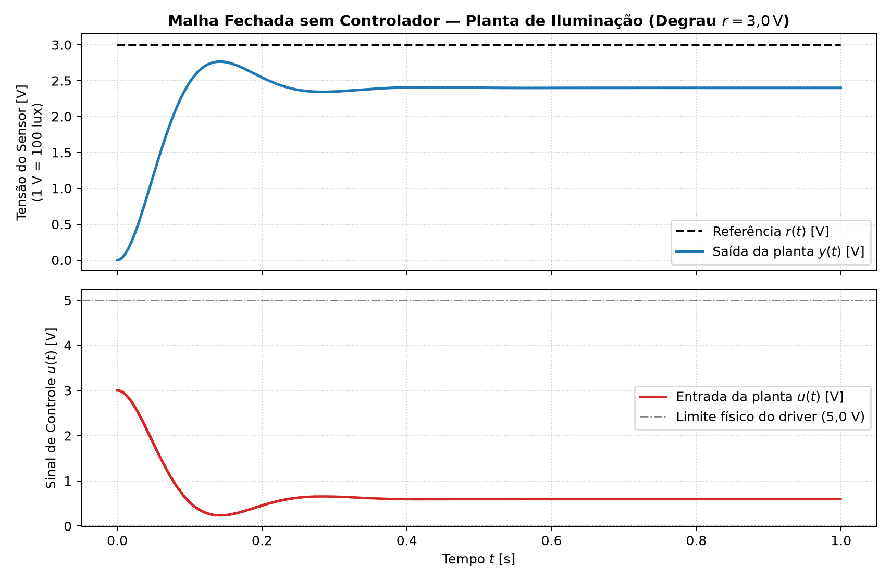
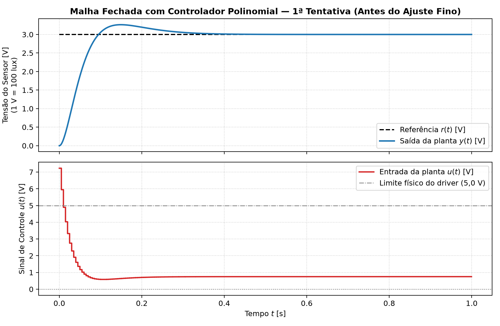
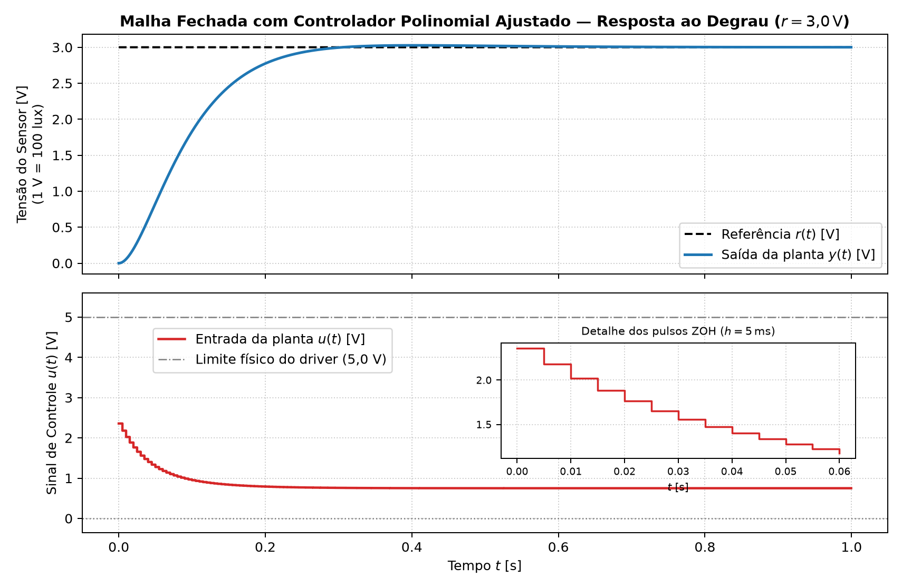
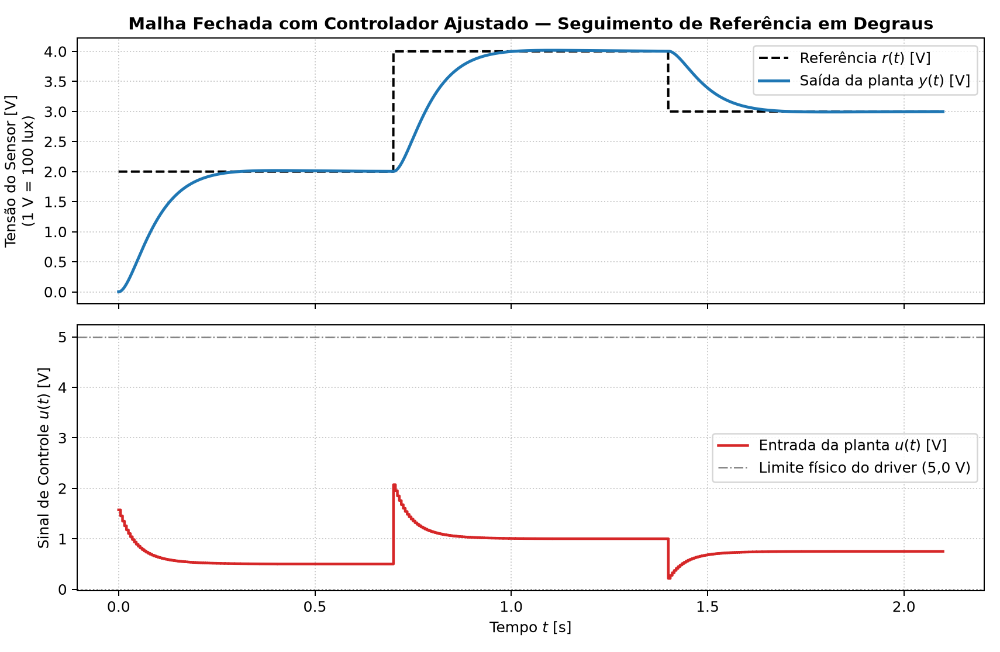

# Controle Digital de Sistema de Iluminação Adaptativa via Método Polinomial

**Disciplina:** Controle Digital (2026/2)  
**Ferramenta de Simulação:** Python 3 (`numpy`, `matplotlib`) — [simulacao_iluminacao.py](simulacao_iluminacao.py)

---

## 1. Introdução

O controle automático de iluminação adaptativa tem papel relevante em ambientes de trabalho, laboratórios, estufas agrícolas e sistemas de cultivo protegido (*indoor farming*), nos quais é desejável manter a iluminância sobre uma bancada em um nível de referência especificado (por exemplo, $300\text{ lux}$ a $400\text{ lux}$) com rapidez, estabilidade e baixo consumo energético.

Operar o sistema em malha aberta ou com realimentação unitária sem compensação dinâmica apresenta limitações severas: ganhos baixos produzem erro em regime permanente elevado e resposta lenta, enquanto ganhos altos introduzem oscilações transitórias perceptíveis (cintilação/sobrebrilho).

Neste trabalho, realiza-se a modelagem, análise, projeto de controlador digital e simulação computacional de um sistema de iluminação adaptativa composto por um *driver* de LED e um sensor fotoresistivo (LDR) com circuito condicionador. Seguindo a **Segunda Maneira** de projeto apresentada na disciplina, a planta contínua é discretizada exatamente por Amostrador-Retentor de Ordem Zero (ZOH) e o controlador é projetado diretamente no tempo discreto pelo **Método Polinomial** (Equação Diofantina com Princípio do Modelo Interno).

---

## 2. Descrição da Planta

A planta física considerada é composta por dois subsistemas dinâmicos em cascata, operando na faixa linear de $0$ a $5\text{ V}$:

1. **Estágio de Atuação (Driver de Corrente LED + Luminária):** recebe o sinal de comando $u(t)$ [$\text{V}$] proveniente do conversor D/A e gera a iluminância $\Phi(t)$ [$\text{lux}$] sobre a bancada. Devido à filtragem passa-baixas do estágio de potência PWM, sua dinâmica é modelada por um sistema de 1ª ordem:
   $$\tau_1 \frac{d\Phi(t)}{dt} + \Phi(t) = K_{\text{LED}} \, u(t)$$
   com constante de tempo $\tau_1 = 0{,}05\text{ s}$ ($50\text{ ms}$) e ganho $K_{\text{LED}} = 400\text{ lux/V}$.

2. **Estágio de Sensoriamento (LDR + Amplificador Condicionador):** converte a iluminância $\Phi(t)$ na tensão medida $y(t)$ [$\text{V}$] lida pelo conversor A/D. A inércia fotoquímica do LDR somada ao filtro RC anti-ruído resulta em uma dinâmica de 1ª ordem:
   $$\tau_2 \frac{dy(t)}{dt} + y(t) = K_{\text{LDR}} \, \Phi(t)$$
   com constante de tempo $\tau_2 = 0{,}15\text{ s}$ ($150\text{ ms}$) e sensibilidade calibrada $K_{\text{LDR}} = 0{,}01\text{ V/lux}$ (de modo que $1{,}0\text{ V} \equiv 100\text{ lux}$, cobrindo $0$ a $500\text{ lux}$ na faixa de $0$ a $5\text{ V}$).

Combinando os dois subsistemas no domínio de Laplace (considerando condições iniciais nulas), obtém-se a função de transferência contínua da planta:

$$G(s) = \frac{Y(s)}{U(s)} = \frac{K}{(\tau_1 s + 1)(\tau_2 s + 1)} = \frac{4{,}0}{(0{,}05s + 1)(0{,}15s + 1)} = \frac{533{,}3333}{s^2 + 26{,}6667s + 133{,}3333}$$

onde $K = K_{\text{LED}} \cdot K_{\text{LDR}} = 4{,}0\text{ V/V}$ é o ganho CC total da planta, e o sinal de controle físico do driver é limitado ao intervalo $u(t) \in [0{,}0,\; 5{,}0]\text{ V}$.

---

## 3. Análise da Planta

Da função de transferência $G(s)$ extraem-se as seguintes propriedades fundamentais:

* **Ordem e Tipo:** sistema linear, invariante no tempo, de **2ª ordem** e **Tipo 0** (não possui integrador natural na planta).
* **Polos em Malha Aberta:** ambos são reais e negativos, $s_1 = -\frac{1}{\tau_1} = -20{,}00\text{ rad/s}$ e $s_2 = -\frac{1}{\tau_2} = -6{,}67\text{ rad/s}$. Logo, a planta é **estável em malha aberta** e possui resposta ao degrau superamortecida (sem oscilações naturais).
* **Rapidez em Malha Aberta:** dominada pela constante de tempo mais lenta ($\tau_2 = 0{,}15\text{ s}$), resultando em tempo de acomodação ($2\%$) de aproximadamente $0{,}65\text{ s}$.
* **Parâmetros de Discretização e Simulação (critério do trabalho):**
  * Menor constante de tempo da planta: $\tau_{\min} = \min(\tau_1, \tau_2) = 0{,}05\text{ s}$.
  * Passo de integração da planta contínua (Runge-Kutta de 4ª ordem — RK4):
    $$\Delta t = \frac{\tau_{\min}}{100} = \frac{0{,}05}{100} = 0{,}0005\text{ s} \quad (0{,}5\text{ ms})$$
  * Período de amostragem do controlador discreto:
    $$h = \frac{\tau_{\min}}{10} = \frac{0{,}05}{10} = 0{,}005\text{ s} \quad (5\text{ ms})$$
  * Assim, a cada amostra do controlador são executadas **10 iterações** de integração da planta com $u(t)$ mantido constante (princípio do ZOH).

### Comportamento Analítico em Malha Fechada sem Controlador

Fechando a malha diretamente com realimentação unitária e sem controlador ($C(s) = 1$, logo $u(t) = r(t) - y(t)$):

$$G_{\text{MF,sc}}(s) = \frac{G(s)}{1 + G(s)} = \frac{533{,}3333}{s^2 + 26{,}6667s + 666{,}6667}$$

Comparando com $\frac{K'\omega_n^2}{s^2 + 2\zeta\omega_n s + \omega_n^2}$:
* Frequência natural: $\omega_n = \sqrt{666{,}6667} \approx 25{,}82\text{ rad/s}$;
* Fator de amortecimento: $\zeta = \frac{26{,}6667}{2 \cdot 25{,}82} \approx 0{,}5164 < 1$ (sistema **subamortecido**, portanto apresentará **oscilação/ultrapassagem**);
* Ganho em regime permanente: $\frac{K}{1 + K} = \frac{4}{5} = 0{,}80 \implies$ **erro estacionário de $20\%$** para entrada em degrau.

---

## 4. Simulações em Malha Fechada (sem controlador)

A planta foi simulada em malha fechada contínua (passo $\Delta t = 0{,}0005\text{ s}$) para uma referência em degrau de $r(t) = 3{,}0\text{ V}$ (correspondente a $300\text{ lux}$).



**Observações sobre a simulação sem controlador:**
* **Erro em regime permanente:** a saída estabiliza em $y(\infty) = 2{,}4000\text{ V}$ ($240\text{ lux}$), apresentando erro estacionário de $e_{ss} = 0{,}6000\text{ V}$ (**$20{,}00\%$**), inaceitável para controle de iluminância.
* **Existência de oscilações:** há ultrapassagem clara até $y_{\text{pico}} = 2{,}7656\text{ V}$, equivalente a **$P.O. = 15{,}24\%$** em relação ao valor final de regime ($2{,}40\text{ V}$).
* **Rapidez:** o tempo de acomodação ($2\%$) é $T_{s,2\%} = 0{,}3065\text{ s}$.
* **Entrada da planta:** $u(t)$ parte de $3{,}0\text{ V}$ e estabiliza em $0{,}60\text{ V}$.

### Especificações de Desempenho Desejadas

Para corrigir as deficiências observadas, estabelecem-se os seguintes requisitos para o sistema em malha fechada com o controlador digital:
1. **Erro em regime permanente nulo** para referência em degrau: $e_{ss} = 0\%$;
2. **Ultrapassagem percentual máxima:** $P.O. \le 5{,}0\%$ (evitar variação brusca de brilho perceptível ao olho humano);
3. **Tempo de acomodação ($2\%$):** $T_{s,2\%} \le 0{,}30\text{ s}$;
4. **Sinal de controle realizável:** $0{,}0\text{ V} \le u(t) \le 5{,}0\text{ V}$ (sem exigir tensão negativa nem saturar o driver LED).

---

## 5. Projeto do Controlador

Optou-se pela **Segunda Maneira** de projeto: discretização exata da planta via ZOH seguida de projeto direto no plano $z$ pelo **Método Polinomial** (Equação Diofantina).

### 5.1 Discretização da Planta (ZOH, $h = 0{,}005\text{ s}$)

A função de transferência discreta equivalente com Amostrador-Retentor de Ordem Zero é obtida por:

$$G(z) = \frac{z - 1}{z} \mathcal{Z}\left\{ \mathcal{L}^{-1}\left[\frac{G(s)}{s}\right]_{t = kh} \right\}$$

Os polos contínuos $s_1 = -20\text{ rad/s}$ e $s_2 = -6{,}67\text{ rad/s}$ mapeiam-se para $z_1 = e^{-20 \cdot 0{,}005} = 0{,}904837$ e $z_2 = e^{-6{,}67 \cdot 0{,}005} = 0{,}967216$, resultando em:

$$G(z) = \frac{b(z)}{a(z)} = \frac{0{,}00637823\, z + 0{,}00610097}{z^2 - 1{,}87205352\, z + 0{,}87517332}$$

Como o zero de $b(z)$ está em $z_0 = -0{,}956530$ e os polos de $a(z)$ em $0{,}904837$ e $0{,}967216$, os polinômios $a(z)$ e $b(z)$ são **coprimos**.

### 5.2 Formulação pelo Método Polinomial com Princípio do Modelo Interno

Deseja-se projetar o controlador $C(z) = \frac{p(z)}{\ell(z)}$ de modo que a função de transferência em malha fechada seja:

$$\frac{Y(z)}{R(z)} = \frac{p(z)b(z)}{a(z)\ell(z) + b(z)p(z)} = \frac{p(z)b(z)}{a^*(z)}$$

Para garantir **erro em regime permanente nulo** a uma referência em degrau ($r(k) = c$), aplica-se o Princípio do Modelo Interno impondo $\ell(z) = (z - 1)\ell_2(z)$. Assim, a Equação Diofantina torna-se:

$$\underbrace{[a(z)(z - 1)]}_{\tilde{a}(z),\;\text{grau } 3} \ell_2(z) + b(z)p(z) = a^*(z)$$

Escolhendo $a^*(z)$ mônico de grau $n_{a^*} = 4 > n_{\tilde{a}} = 3$, o teorema garante solução única com:
$$\ell_2(z) = z + \ell_{20} \quad \text{e} \quad p(z) = p_2 z^2 + p_1 z + p_0$$
o que gera um controlador **causal (bipróprio)** de 2ª ordem ($n_p = n_\ell = 2$).

### 5.3 Tentativa Inicial e Ajuste Fino da Sintonia

* **1ª Tentativa (polos agressivos):** alocou-se $a^*(z)$ correspondente aos polos contínuos $s \in \{-18,\; -18,\; -30,\; -30\}\text{ rad/s}$ ($z \in \{0{,}913931,\; 0{,}913931,\; 0{,}860708,\; 0{,}860708\}$), obtendo:
  $$\ell(z) = z^2 - 1{,}692599\, z + 0{,}692599, \qquad p(z) = 2{,}410422\, z^2 - 4{,}470574\, z + 2{,}071670$$
  Na simulação, embora $e_{ss} = 0$, os zeros introduzidos por $p(z)$ elevaram a ultrapassagem para **$P.O. = 8{,}79\%$** ($> 5\%$) e o pico de controle inicial atingiu **$u_{\max} = 7{,}2313\text{ V}$** (violando o limite de $5{,}0\text{ V}$ do driver).

* **Ajuste Fino (Sintonia Final):** suavizaram-se os polos dominantes para $s \in \{-10,\; -10,\; -25,\; -25\}\text{ rad/s}$, ou seja, $z \in \{0{,}951229,\; 0{,}951229,\; 0{,}882497,\; 0{,}882497\}$:
  $$a^*(z) = z^4 - 3{,}66745265\, z^3 + 5{,}04146628\, z^2 - 3{,}07866888\, z + 0{,}70468809$$
  Resolvendo o sistema linear $4 \times 4$ da Equação Diofantina, obtêm-se os polinômios finais do controlador:
  $$\ell(z) = (z - 1)(z - 0{,}800410) = z^2 - 1{,}800410\, z + 0{,}800410$$
  $$p(z) = 0{,}785669\, z^2 - 1{,}469869\, z + 0{,}686831$$
  Logo, a função de transferência do controlador discreto é:
  $$C(z) = \frac{U(z)}{E(z)} = \frac{0{,}785669\, z^2 - 1{,}469869\, z + 0{,}686831}{z^2 - 1{,}800410\, z + 0{,}800410}$$

---

## 6. Algoritmo (controlador)

Dividindo numerador e denominador de $C(z)$ por $z^2$, obtém-se a equação a diferenças causal para implementação em tempo real a cada período de amostragem $h = 0{,}005\text{ s}$:

$$u(k) = -\ell_1 u(k - 1) - \ell_0 u(k - 2) + p_2 e(k) + p_1 e(k - 1) + p_0 e(k - 2)$$

onde $\ell_1 = -1{,}800410$, $\ell_0 = 0{,}800410$, $p_2 = 0{,}785669$, $p_1 = -1{,}469869$ e $p_0 = 0{,}686831$.

No padrão estruturado utilizado na disciplina:

```c
// Parametros
h    = 0.005;
ell1 = -1.800410;
ell0 =  0.800410;
p2   =  0.785669;
p1   = -1.469869;
p0   =  0.686831;

// Inicializacao das variaveis
u_ant1 = 0.0;
u_ant2 = 0.0;
e_ant1 = 0.0;
e_ant2 = 0.0;

// Algoritmo executado a cada periodo de amostragem h
while (loop)
{
    // Leitura do valor de y pela porta 1 do conversor A/D
    y = vin1();

    // Valor da referencia
    r = 3.0;

    // Calculo do erro e
    e = r - y;

    // Calculo do sinal de controle u
    u = -ell1 * u_ant1 - ell0 * u_ant2 + p2 * e + p1 * e_ant1 + p0 * e_ant2;

    // Atualizacao das variaveis
    u_ant2 = u_ant1;
    u_ant1 = u;
    e_ant2 = e_ant1;
    e_ant1 = e;

    // Envio do valor de u pela porta 1 do conversor D/A (ZOH durante h)
    vout1(u);
}
```

A implementação completa em Python encontra-se em [simulacao_iluminacao.py](simulacao_iluminacao.py).

---

## 7. Simulações em Malha Fechada com o controlador

Todas as simulações foram executadas integrando a planta contínua por RK4 com $\Delta t = 0{,}0005\text{ s}$ e atualizando o algoritmo do controlador a cada $h = 0{,}005\text{ s}$ (10 passos por pulso ZOH).

### 7.1 Comparação: 1ª Tentativa vs. Controlador Ajustado ($r = 3{,}0\text{ V}$)

Na 1ª tentativa (Figura 2), observa-se a ultrapassagem excessiva ($8{,}79\%$) e a violação do limite de $5{,}0\text{ V}$ do driver LED no instante inicial ($u_{\max} = 7{,}23\text{ V}$).



Após o ajuste fino dos polos para $s \in \{-10, -10, -25, -25\}\text{ rad/s}$ (Figura 3), o sistema atende integralmente a todas as especificações, mantendo $u(t)$ suave e dentro da faixa operacional $[0,\; 5]\text{ V}$, com o detalhe em degraus do retentor ZOH evidenciado no gráfico inferior.



| Configuração | $y_{\text{final}}$ [V] | Erro $e_{ss}$ [%] | $P.O.$ [%] | $T_{s,2\%}$ [s] | $u_{\min}$ / $u_{\max}$ [V] | Especificações |
| :--- | :---: | :---: | :---: | :---: | :---: | :---: |
| Sem controlador | $2{,}4000$ | $20{,}00\%$ | $15{,}24\%$ | $0{,}3065$ | $0{,}22$ / $3{,}00$ | Não atende |
| 1ª Tentativa (polos $-18, -30$) | $3{,}0000$ | $0{,}00\%$ | $8{,}79\%$ | $0{,}2945$ | $0{,}58$ / $7{,}23$ | Reprovado ($P.O.$ e $u_{\max}$) |
| **Ajuste Final (polos $-10, -25$)** | **$3{,}0005$** | **$\approx 0{,}00\%$** | **$0{,}88\%$** | **$0{,}2565$** | **$0{,}75$ / $2{,}36$** | **Atende todas** |

### 7.2 Ensaio Complementar: Seguimento de Referência em Múltiplos Degraus

Para verificar o comportamento diante de mudanças consecutivas no nível de iluminação desejado ($200\text{ lux} \to 400\text{ lux} \to 300\text{ lux}$, isto é, $2{,}0\text{ V} \to 4{,}0\text{ V} \to 3{,}0\text{ V}$), simulou-se a malha fechada com o controlador ajustado durante $2{,}1\text{ s}$ (Figura 4).



Verifica-se que o controlador rastreia todos os patamares com erro nulo ($y(0{,}699\text{ s}) = 2{,}0037\text{ V}$, $y(1{,}399\text{ s}) = 4{,}0037\text{ V}$, $y(2{,}099\text{ s}) = 2{,}9982\text{ V}$), ultrapassagem inferior a $1\%$ e sinal de controle sempre positivo e dentro dos limites do driver ($u \in [0{,}2142,\; 2{,}0712]\text{ V}$).

---

## 8. Conclusões

O projeto demonstrou de forma clara o impacto do controle digital no desempenho do sistema de iluminação adaptativa:
* Em malha fechada sem controlador, a planta apresentou erro em regime permanente de $20\%$ e ultrapassagem de $15{,}24\%$, incompatíveis com o controle preciso de iluminância.
* A **Segunda Maneira** (discretização exata por ZOH seguida de projeto pelo **Método Polinomial**) permitiu impor o Princípio do Modelo Interno ($\ell_1(z) = z - 1$), eliminando completamente o erro estacionário sem necessidade de reprojeto analógico.
* O processo de simulação evidenciou a importância do ajuste fino dos polos desejados $a^*(z)$: uma alocação excessivamente rápida causou ultrapassagem de $8{,}79\%$ (devido aos zeros de $p(z)$) e pico de controle acima de $5\text{ V}$, enquanto o ajuste final levou o sistema a **$P.O. = 0{,}88\%$**, **$T_{s,2\%} = 0{,}2565\text{ s}$**, erro estacionário nulo e esforço de controle $u(t) \in [0{,}75,\; 2{,}36]\text{ V}$ totalmente compatível com o driver LED.
* O algoritmo resultante resume-se a uma equação a diferenças causal de 2ª ordem com apenas 5 multiplicações e 4 somas por amostra ($h = 5\text{ ms}$), sendo leve o suficiente para execução em qualquer microcontrolador simples.

---

## 9. Bibliografia

1. **Notas de Aula da Disciplina de Controle Digital (2026/2)** — *Análise de Sistemas, Discretização de Controladores e Método Polinomial de Projeto de Controladores* (Arquivos `Controle_Digital_-_07` a `11_-_2026_-_2.pdf`).
2. **ÅSTRÖM, K. J.; WITTENMARK, B.** *Computer-Controlled Systems: Theory and Design*. 3rd ed. Prentice Hall, 1997.
3. **OGATA, K.** *Discrete-Time Control Systems*. 2nd ed. Prentice Hall, 1995.
4. **FRANKLIN, G. F.; POWELL, J. D.; WORKMAN, M. L.** *Digital Control of Dynamic Systems*. 3rd ed. Addison-Wesley, 1998.
